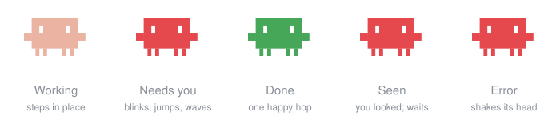
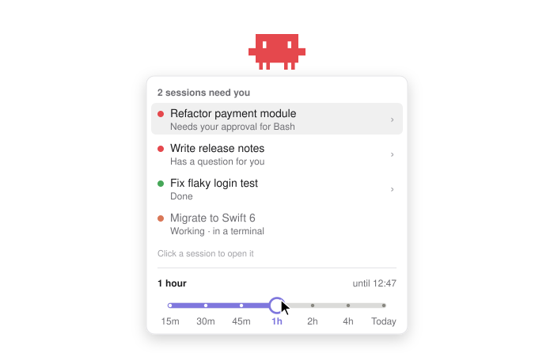
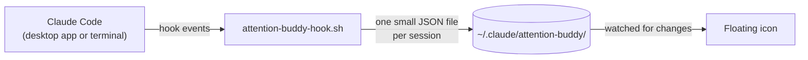

<p align="center">
  
</p>

<h1 align="center">Attention Buddy</h1>

<p align="center">
  <b>A tiny floating Claude Code buddy that jumps and waves when a session needs you.</b>
</p>

<p align="center">
  <a href="https://github.com/zahorovskyi/attention-buddy/actions/workflows/ci.yml"></a>
  
  
  <a href="LICENSE"></a>
</p>

<p align="center">
  <a href="#install">Install</a> ·
  <a href="#how-it-works">How it works</a> ·
  <a href="#update">Update</a> ·
  <a href="docs/DESIGN.md">Design</a> ·
  <a href="#for-ai-agents">For AI agents</a>
</p>

<p align="center">
  
</p>

<p align="center">
  <picture>
    <source media="(prefers-color-scheme: dark)" srcset="docs/assets/hover-card-dark.svg">
    
  </picture>
  <br>
  <sub>Hover over or click the icon to see every session, then click one to open it.</sub>
</p>

## Why

Claude Code sessions run in the background while you do something else. When one stops to ask for
approval or a question, it just waits, and banners disappear while sounds get muted.

Attention Buddy is a small always-on-top mascot you drag anywhere on your screen. It stays calm
while Claude works and starts blinking red and waving the moment any session needs you.

- **Visual, silent, always there.** No sounds and no banners that vanish.
- **Every session at once.** One icon watches all your Claude Code sessions, in the desktop app
  and in the terminal.
- **Yours to place and size.** Drag it anywhere; make it up to four times bigger in Settings.
- **Tiny and native.** One small Swift app, no web runtime, near-zero CPU.
- **Private.** No network access. It never reads your prompts, code or tool output.
- **One click to the right session.** Pick any session from the card and Claude opens it.

## What it shows

| State | Looks like | When |
| --- | --- | --- |
| **Working** | dim clay color, legs stepping | Claude is working |
| **Needs you** | red, blinking, jumps and waves every 15 s | a session asks for approval, asks a question, or an MCP server needs input |
| **Seen** | steady red | you looked (switched to Claude or clicked the icon) but have not answered yet; goes back to blinking after 3 minutes |
| **Done** | green, one happy hop | a session finished its turn |
| **Error** | red, shakes its head | a turn failed, for example on an API error |

With several sessions, the icon shows the most urgent one: needs you, error, seen, done, working.

## How it works



1. Claude Code runs a tiny hook script on a few events: a permission request, a tool finishing,
   the end of a turn, and so on.
2. The script writes the session's state to `~/.claude/attention-buddy/<session>.json`.
3. The icon reads those files and shows the most urgent state. Sessions whose process has exited
   are cleaned up automatically.

The full design, including every event and decision, is in [docs/DESIGN.md](docs/DESIGN.md).

## Install

**Requirements:** macOS 13 or later, the Xcode Command Line Tools (`xcode-select --install`) and
`jq` (included in macOS 15 and later; otherwise `brew install jq`). Attention Buddy builds from
source on your Mac, so there is no unsigned download to approve.

Pick **one** method:

| Method | Install with | The icon starts |
| --- | --- | --- |
| **Claude Code plugin** (no terminal) | In Claude Code:<br>`/plugin marketplace add zahorovskyi/attention-buddy`<br>`/plugin install attention-buddy@attention-buddy` | with each Claude Code session |
| **One-line install** | `curl -fsSL https://raw.githubusercontent.com/zahorovskyi/attention-buddy/main/install.sh \| sh` | at login |
| **From a clone** | `git clone https://github.com/zahorovskyi/attention-buddy.git`<br>`cd attention-buddy && ./install.sh` | at login |
| **Homebrew** | `brew install zahorovskyi/tap/attention-buddy`<br>`attention-buddy setup`<br>`brew services start attention-buddy` | at login |

- **Plugin:** it brings its own hooks. On your next session start it builds the icon in the
  background (about 10 seconds) and starts it.
- **One-line install and clone:** they build the app, install `~/.local/bin/attention-buddy`, add
  the hooks to `~/.claude/settings.json` (after making a backup) and add a login item. The
  one-line install downloads the latest release first. Prefer to read it before running? Download
  [install.sh](install.sh), read it, then run `sh install.sh`; add `--dry-run` to see what it
  would change.
- **Homebrew:** `setup` adds the hooks to `~/.claude/settings.json` (with a backup), and
  `brew services` starts the icon now and at every login.

Check that everything is connected:

```bash
attention-buddy doctor
```

With the plugin, the app is not on your `PATH`; run it from the plugin's data folder instead:
`~/.claude/plugins/data/attention-buddy-attention-buddy/bin/attention-buddy doctor`.

## Update

| Method | Update with |
| --- | --- |
| **Claude Code plugin** | `claude plugin marketplace update attention-buddy`<br>`claude plugin update attention-buddy@attention-buddy`<br>or turn on auto-update for the marketplace in `/plugin` → Marketplaces |
| **One-line install** | run the same `curl -fsSL https://raw.githubusercontent.com/zahorovskyi/attention-buddy/main/install.sh \| sh` line again |
| **From a clone** | `git pull && ./install.sh` |
| **Homebrew** | `brew update && brew upgrade attention-buddy` |

The running icon notices that it was updated and switches to the new version by itself within a
second or two; there's nothing to restart. Plugin updates are built at your next Claude Code
session start (about 10 seconds), then the icon switches. To hear about new versions, watch the
repository's releases on GitHub (Watch → Custom → Releases); the app itself never goes online.

## Using it

- **Drag** the icon anywhere. It remembers the spot, even across restarts and display changes.
- **Hover** or **click** it to see every session and what it needs. Hovering opens the card after
  a moment and closes it when you move away; clicking opens it at once and keeps it open until you
  choose something or click elsewhere.
- **Click a session** in the card to open exactly that session in the Claude desktop app. Terminal
  sessions are listed too, marked "in a terminal", but can't be opened from the card.
- **Renamed a session** in Claude Desktop? The open card shows the new name within about half a
  second. (No hook reports renames, so the card reads the name from the desktop app.)
- In the card, the **dot** of a session that needs you **blinks red**, a working session's dot
  breathes slowly, and the others stay steady.
- **Right-click** it for "Show waiting sessions", "Mark all as seen", "Forget all sessions",
  "Settings…", "About Attention Buddy" (opens this page), "Hide until next session" and "Quit".
- It starts near the **bottom-right corner** of your screen, just above the Dock.
- **Resize** it in Settings…: a slider from the smallest size (1×) up to four times bigger (4×);
  it starts at 2×. The icon changes live as you drag. It grows away from its nearest screen corner, so it stays in
  place, and it keeps its size.

Advanced settings, from a terminal:

| Setting | Default | Example |
| --- | --- | --- |
| Seconds until "seen" asks again | 180 | `defaults write io.github.zahorovskyi.attention-buddy seenTimeout -float 300` |
| Seconds between waves | 15 | `defaults write io.github.zahorovskyi.attention-buddy repeatInterval -float 30` |

Restart the icon after changing these: right-click, choose "Hide until next session", then start
a new Claude Code session. With **Reduce Motion** turned on in macOS, it keeps the colors and the
blink but skips the animations.

### Closing and starting the icon

The right-click menu has two ways to close the icon:

- **Hide until next session:** it comes back by itself with your next Claude Code session.
- **Quit:** it stays closed, even when you start new sessions, until you next log in to your Mac
  (a restart, or logging out and in). With the plugin, which has no login item, it comes back
  after a restart.

Restarting Claude Desktop doesn't bring it back either way. To start it yourself at any time,
which also ends a Quit:

| Method | Start it with |
| --- | --- |
| **Claude Code plugin** | `/attention-buddy:start` in Claude Code |
| **One-line install** or **From a clone** | `attention-buddy`, or `launchctl kickstart gui/$(id -u)/io.github.zahorovskyi.attention-buddy` |
| **Homebrew** | `brew services restart attention-buddy` |

## What it changes on your Mac

| What | Plugin | Install script | Homebrew |
| --- | --- | --- | --- |
| The app | built into Claude Code's plugin data folder | `~/.local/bin/attention-buddy` | Homebrew prefix |
| Hooks | inside the plugin | added to `~/.claude/settings.json`, with a backup | added by `attention-buddy setup`, with a backup |
| Start at login | no; starts with Claude Code | `~/Library/LaunchAgents/io.github.zahorovskyi.attention-buddy.plist` | `brew services` |
| Session state | `~/.claude/attention-buddy/` | same | same |
| Preferences (position, size) | `~/Library/Preferences/io.github.zahorovskyi.attention-buddy.plist` | same | same |

Nothing else. No network access, no telemetry, no accounts. To open the session you click and
show its current name, the app also reads (never changes) the Claude desktop app's list of
sessions in `~/Library/Application Support/Claude/claude-code-sessions/`, and uses only each
session's ids and title.

## Uninstall

| Method | Remove with |
| --- | --- |
| **Claude Code plugin** | In Claude Code:<br>`/plugin uninstall attention-buddy`<br>then right-click the icon and choose Quit |
| **One-line install** | `sh ~/.local/share/attention-buddy/install.sh --uninstall` |
| **From a clone** | `./install.sh --uninstall` (in the clone), or the same command as the one-line install |
| **Homebrew** | `attention-buddy setup --remove`<br>`brew services stop attention-buddy`<br>`brew uninstall attention-buddy` |

The install script also deletes the session state and preferences. After removing the plugin or
the Homebrew formula, delete them yourself if you like:

```bash
rm -rf ~/.claude/attention-buddy
defaults delete io.github.zahorovskyi.attention-buddy
```

## Troubleshooting

Run `attention-buddy doctor` first. It checks the hooks, `jq`, the state folder and whether the
icon is running.

- **The icon never changes.** The hooks are not connected or not allowed. Organizations can
  restrict hooks with managed settings (`allowManagedHooksOnly`, `disableAllHooks`); `doctor`
  reports this.
- **Installed twice** (plugin and script). It still works, but remove one; `doctor` tells you which.
- **The icon is off screen.** It moves back by itself when displays change. You can also reset
  its spot to the bottom-right corner: `defaults delete io.github.zahorovskyi.attention-buddy positionX`,
  then restart the icon.
- **`attention-buddy` is killed as soon as it starts** (`zsh: killed`, exit code 137) after
  upgrading with the install script while the icon was running: run the installer again. Since
  0.1.7 the installer replaces the app safely, so this no longer happens.
- **The icon is too small or too big.** Right-click it and choose Settings….
- **The icon is gone.** After "Hide until next session" it returns with your next session; after
  Quit, at your next login. To start it now, see
  [Closing and starting the icon](#closing-and-starting-the-icon).

## For AI agents

Point your coding agent at this repository and ask, for example:

> Read https://github.com/zahorovskyi/attention-buddy and help me install it.

Agents will find:

- [AGENTS.md](AGENTS.md): what the app does, which install method to pick, exact commands, how to
  verify and uninstall, and how to work on the code.
- [llms.txt](llms.txt): a short index with direct links to every document.

## Contributing

See [CONTRIBUTING.md](CONTRIBUTING.md) for building, testing and the release process.

## License

[MIT](LICENSE) © zahorovskyi.

Attention Buddy is an independent project. It is not affiliated with, endorsed by or sponsored by
Anthropic. "Claude" and the Claude Code mascot artwork belong to Anthropic and are not covered by
the MIT license; see [NOTICE](NOTICE).
