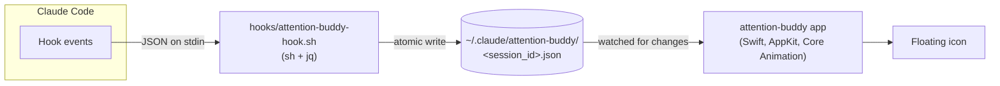

# Attention Buddy design

This document explains what Attention Buddy does, how it is built and why. It is written for
contributors and for anyone (or any AI agent) who wants to understand the app before trusting it.

## Goal

Claude Code sessions often run in the background. When a session stops to ask for approval, asks
a question or finishes, nothing on screen says so unless you look at Claude. Notification banners
disappear after a few seconds and sounds get muted.

Attention Buddy shows a small, always visible, draggable icon (the Claude Code mascot). It is calm
while Claude works and asks for attention, visually and silently, when a session needs you.

**Goals**

- Notice within a second that any session needs you, from anywhere on screen.
- No sound, no banners, no focus stealing.
- Work for every Claude Code session on the Mac: desktop app and terminal.
- Be tiny, native and private: no network access, no prompt or code content stored.
- Never change or slow down Claude Code.

**Non-goals**

- Cloud or remote sessions (their hooks run on another machine).
- Windows or Linux.
- Replacing Claude's own notifications. Attention Buddy complements them.

## Architecture



Two independent parts talk through small files:

1. **The hook script** turns Claude Code hook events into one state file per session.
2. **The app** reads those files, decides what to show, and draws the animated icon.

The app watches the state folder with a file system event source, so it reacts as soon as a file
changes. A poll every 0.5 s handles what events can't: the "seen" timeout, repeated animations and
sessions whose process exited. The app opts out of App Nap, which would otherwise slow its timers
while it sits in the background.

Files instead of sockets keep the parts decoupled. The app can be restarted at any time, there are
no ports or tokens, and state is easy to inspect with `cat`.

## Hook events and session states

The hook is registered for these events. All of them run synchronously, with a 10 second timeout.
The script never prints anything and always exits 0, so Claude Code's behavior never changes.

| Event | New status | Notes |
| --- | --- | --- |
| `SessionStart` | `idle` | Only when the session is new. It also fires on resume, `/clear` and compaction, so a known session is never reset. |
| `UserPromptSubmit` | `working` | Also fires for messages sent while Claude is working. Stores the session title when Claude Code provides one. |
| `PermissionRequest` | `needs` (approval, or question for `AskUserQuestion`) | Fires the moment the prompt appears. Claude Code's `Notification` event only fires about 6 seconds later, so it is not used. |
| `PostToolUse`, `PostToolUseFailure`, `PermissionDenied` | `working` | Clears a pending approval only if it is the same tool call (see below). |
| `Elicitation` | `needs` (input) | An MCP server asks the user for input. |
| `ElicitationResult` | `working` | The user answered it. |
| `Stop` | `done` | The turn ended and Claude waits for the next prompt. |
| `StopFailure` | `error` | The turn failed, for example on an API error. |
| `SessionEnd` | file deleted | |

`SubagentStop` and `Notification` are deliberately not used. Claude Code fires an internal
`SubagentStop` right after `Stop`, which would make the icon flicker.

### Matching an approval with its result

`PermissionRequest` does not include a tool call id, and several tools can run in parallel. If
another tool finishes while Claude waits for approval, its `PostToolUse` must not clear the
request. The hook therefore stores a fingerprint of the waiting call: the first 16 hex characters
of the SHA-256 of `[tool_name, tool_input]`. A tool event only clears the request when its
fingerprint matches. Questions (`AskUserQuestion`) are the exception: Claude Code adds the user's
answers to the tool input, so they match by tool name only, which is safe because only one
question can be open at a time. A new prompt, `Stop` or `StopFailure` always replaces the state.

### Why synchronous hooks

Claude Code can run hooks asynchronously, but asynchronous runs can finish out of order: a late
`PostToolUse` could overwrite a `Stop` and show "working" forever. The hook is fast (around 25 to 60
ms, and it skips the write when nothing changed), so running in order is worth it.

### Concurrency and atomic writes

Hooks for one event run in parallel, for example when several tools finish together. Each session
update holds a lock folder (`.<session>.lock`, created with `mkdir`, which is atomic). The new
state goes to a temporary file that is then moved into place, so the app never reads a half-written
file. A lock left behind by a crashed run is taken over after two seconds.

### State file format

```json
{
  "version": 1,
  "session_id": "3f1c…",
  "status": "needs",
  "reason": "approval",
  "tool": "Bash",
  "cwd": "/path/to/project",
  "title": "Fix the login page",
  "pending_key": "1234abcd1234abcd",
  "pid": 12345,
  "stamp": "1700000000-4242",
  "updated_at": 1700000000
}
```

- `pid` is the Claude Code process that owns the session. If a wrapping shell sits in between, the
  hook records the shell's parent instead. The app deletes files whose process has exited, which
  also cleans up after crashes.
- `stamp` changes on every write, so the app can tell a new request from an old one.
- The app tolerates missing or unknown fields, so newer hook scripts never break older apps.

Only the event name, session id, tool name, working folder and session title are stored. Prompts,
code and tool output are never written anywhere. To open sessions, the app also reads the desktop
app's session files (see Interaction), using only the two ids in each.

## What the icon shows

### Priority

Each session maps to one icon state. With several sessions, the icon shows the highest:

**needs you > error > seen > done > working > idle**

### "Seen"

When the user switches to the Claude desktop app or clicks the icon, every waiting session is
marked **seen**: the icon stops blinking and jumping and turns steady red. This avoids nagging
after the user has noticed, and covers a gap in the events: after you approve a long command, no
event arrives until it finishes.

A seen mark expires after **3 minutes** (`seenTimeout`), so a forgotten request asks for attention
again. Looking again restarts the timer. A new request from the same session (a new `stamp`) is
never treated as seen.

### Looks and animations

| State | Color | Looping | One-shot |
| --- | --- | --- | --- |
| idle | clay `#D97757` at 55% | eye blink | none |
| working | clay at 55% | legs step, body bobs, eye blink | none |
| needs you | red `#E5484D` | pulse (fade in and out every second) | jump and right-arm wave on entry, then every 15 s |
| seen | red | eye blink | none |
| done | green `#46A758` | eye blink | hop with both arms up on entry |
| error | red | none | head shake on entry |

With macOS **Reduce Motion** on, only colors and the pulse remain.

The mascot is split into separate layers (body with eye holes, two arms, four legs) inside two
containers: `motion` (jump, squash, shake) and `figure` (bob, pulse). Arms rotate around the
shoulders and squash pivots between the feet. All animation runs in Core Animation on the GPU.

## The window

- A borderless, non-activating `NSPanel` at status-bar level. It shows on every desktop and over
  full-screen apps, and never takes focus or appears in the Dock or app switcher.
- The view fills its box with an almost invisible color, because macOS lets clicks pass through
  fully transparent pixels. That keeps the gaps between the legs grabbable.
- It starts 24 points in from the bottom-right corner of the main screen's visible area, so above
  the Dock. The position is saved after each drag and checked against the connected screens at
  launch and when displays change; an icon left on an unplugged display moves back to that corner.
- A `flock`-based single-instance lock (`.icon.lock` in the state folder) makes sure only one icon
  runs, however many launchers start it. The lock frees itself when the process exits or crashes.

## Interaction

- **The session card** (a separate borderless panel with the system popover material) has a
  summary line and one row per session, most urgent first: a dot in the state's color, the session
  name and what it needs, up to six rows plus "+N more sessions". It sits below the icon, or above
  it near the bottom of the screen, and updates live. VoiceOver reads the same text from the icon.
- **Card dots** follow the icon's rhythm: a "needs you" dot blinks red with the icon's 1-second
  pulse (kept with Reduce Motion, as the main signal), a working dot breathes slowly (2.4 s, off
  with Reduce Motion), and seen, done, error and idle dots stay steady.
- **When the card opens and closes** is decided by `CardPresenter`, a small state machine:
  - Hover: the card opens after 0.35 s and closes 0.25 s after the pointer has left both the icon
    and the card, so moving from the icon onto the card keeps it open.
  - Click on the icon: the card opens at once and is pinned. It stays open until the icon is
    clicked again, a session is chosen, or the user clicks anywhere else (a global mouse monitor
    sees clicks in other apps; it needs no special permission). Dragging the icon, resizing it or
    opening the menu also closes it. The click also marks every waiting session as seen.
- **Choosing a session:** rows of desktop app sessions highlight under the pointer, show a `›` and
  open that exact session: `claude://code/needs-input?session=local_…` for a waiting session,
  `claude://code/continue?session=local_…` otherwise. The chosen session is marked as seen.
  Sessions the desktop app doesn't know (terminal sessions) are dimmed, marked "in a terminal"
  and can't be clicked. If a link can't be built at click time, the app just brings Claude to the
  front.
- **Desktop session ids:** hook events carry Claude Code's session id; the desktop links need the
  app's own `local_…` id. `DesktopSessionIndex` reads the desktop app's per-session files in
  `~/Library/Application Support/Claude/claude-code-sessions/` (read-only, files over 5 MB
  skipped) and maps `cliSessionId` to `sessionId`, checking ids with the same pattern the app
  uses. It rescans at most every 5 seconds when it meets an unknown session. These files are not
  a published interface; if they change, rows simply become unclickable.
- **Right-click:** a menu of actions only: Show waiting sessions, Mark all as seen, Forget all
  sessions, Settings…, About Attention Buddy (opens the project page) and Quit. The sessions
  themselves are listed in the hover card. No item has an icon, so all of them line up. macOS 26
  adds a symbol on its own to items whose action name looks standard (an action named
  `openSettings` gets a gear and indents its whole group), so the Settings item's action has the
  neutral name `openConfigurationWindow`; a test guards this.
- **Settings…:** a small regular window; the app activates only while it is open. Its slider sets
  the icon scale from 1.5 to 6 points per icon pixel, shown as 1× to 4×, and applies live. New
  installs start at 3 (2×). Each
  change builds an icon view of the new size and resizes the window before attaching it, because
  attaching a view to a window first shrinks the view to the old window size and clips it. The
  edges nearest the screen corner stay fixed, so the icon grows away from its corner, shrinking
  returns it exactly, and it is kept on screen.
- **Quit:** exits cleanly. The login item and `brew services` restart the icon only after a crash,
  not after Quit; the plugin starts it again with the next Claude Code session.

## Preferences

Stored with `UserDefaults` in the domain `io.github.zahorovskyi.attention-buddy`
(`~/Library/Preferences/io.github.zahorovskyi.attention-buddy.plist`). Every value is clamped to
its range when read, so a hand-edited value can't break the app.

| Key | Set by | Default | Range |
| --- | --- | --- | --- |
| `positionX`, `positionY` | dragging the icon | bottom-right corner | any spot on a connected screen |
| `scale` | the Settings slider | 3 (2×) | 1.5 to 6 (1× to 4×) |
| `seenTimeout` | `defaults write` | 180 seconds | 10 to 3600 |
| `repeatInterval` | `defaults write` | 15 seconds | 5 to 600 |

## Commands

| Command | What it does |
| --- | --- |
| `attention-buddy` | Runs the icon. Exits at once if another copy holds the lock. |
| `attention-buddy setup` | Adds the hooks to `settings.json` via the bundled `install.sh --hooks-only`. |
| `attention-buddy setup --remove` | Removes them again. |
| `attention-buddy doctor` | Checks hooks (settings or plugin, or both), organization restrictions, `jq`, the state folder and whether the icon runs. |
| `attention-buddy snapshot <dir>` | Renders PNGs of every state, for documentation and checks. |

## Install methods

All four share the same app code and hook script; only the installer differs.

| Method | Hooks | Start | Notes |
| --- | --- | --- | --- |
| Claude Code plugin | `hooks/hooks.json`, inside the plugin | plugin `SessionStart` runs `scripts/plugin-start.sh` | Builds once per plugin version into `${CLAUDE_PLUGIN_DATA}` (kept across updates), in the background. Prints nothing, except one note if the Command Line Tools are missing. |
| One-line install | `install.sh` merges them into `settings.json` | LaunchAgent | Downloads the latest release's source tarball. |
| Clone | same script, local source | LaunchAgent | |
| Homebrew | `attention-buddy setup` | `brew services` | The formula can't write to the home folder during install, hence the separate `setup` step. The hook path uses Homebrew's stable `opt` link so it survives upgrades. |

`install.sh` backs up `settings.json` before every change, is safe to run twice, removes only its
own entries, aborts without changes on invalid JSON, and supports `--dry-run`. When the plugin is
installed it skips its own hooks unless `--force` is given. Installing twice is harmless anyway:
both write the same state, and the second icon exits because of the lock.

### Why the installers use plain `swiftc`

Development uses SwiftPM (`swift build`, `swift test`). User installs compile with
`scripts/build.sh`, which calls `swiftc` directly and only needs the Command Line Tools. SwiftPM
in a Command Line Tools install can break on its own, for example when the tools are newer than
the system SDK, while plain `swiftc` keeps working. `build.sh` compiles all sources into one
module; `#if canImport(...)` guards skip the cross-module imports SwiftPM needs.

## Decisions and alternatives

| Decision | Alternatives considered | Why |
| --- | --- | --- |
| Native Swift app | Electron or Tauri desktop pet apps; a Claude Code plugin pane | A web runtime to draw one icon is heavy. Plugin panes live inside the Claude window, but the icon must float over every app. |
| Hook script in `sh` + `jq` | The Swift binary as the hook | A shell script starts in milliseconds; loading AppKit for every hook event would be slower. |
| Files, watched with file system events plus a 0.5 s poll | Unix socket | Simplest, no daemon protocol, survives restarts; reacting to folder events is instant and reading a few small files costs almost nothing. |
| Custom session card | The system tooltip | System tooltips can't be styled or clicked; the card uses the popover material, follows light and dark mode, shows a colored dot per session and opens the one you click. |
| Hover and click both open the card | Click opens the most urgent session | Choosing the session yourself is predictable with several sessions; hover gives a quick look. |
| Synchronous hooks | `async: true` | Event order matters more than the few milliseconds saved. |
| `PermissionRequest` | `Notification` (`permission_prompt`) | Fires immediately instead of after about 6 seconds. |
| Build from source | Prebuilt download | Unsigned downloads trigger Gatekeeper warnings; signing needs a paid developer account. |
| Plugin name `attention-buddy` | `claude-…` names | Claude Code reserves plugin names starting with `claude-` for Anthropic. |

## Known limits

- Remote and cloud sessions are not shown; their hooks run elsewhere.
- Organizations can block user hooks (`allowManagedHooksOnly`, `disableAllHooks`); `doctor`
  reports this.
- After approving a long-running tool, the session stays "needs you" (or "seen" once you looked)
  until the tool finishes, because no event arrives in between.
- Only desktop app sessions can be opened from the card; terminal sessions are listed but can't
  be focused. Mapping sessions relies on the desktop app's internal session files, so a Claude
  update could stop rows from opening until Attention Buddy is updated.

## Testing

| Layer | Tool | What it covers |
| --- | --- | --- |
| Core logic | Swift Testing (`Tests/AttentionCoreTests`) | State files, priority, the seen timer with a fixed clock, animation scheduling, dead-process cleanup, settings and the size range, placement (default spot, unplugged screens, the card, resizing without drift), card content and openable rows, desktop session ids and links, when the card opens and closes, the single-instance lock, `doctor` |
| Icon | Swift Testing (`Tests/AttentionUITests`) | Geometry, styles, animation definitions, layer setup, rendered pixels (state colors, transparent eye holes, the raised arm), the session card and its clickable rows, the Settings slider, and resizing the real window without clipping |
| Hook script | bats (`ShellTests/hook.bats`) | Every event, tool-call matching (including answered questions), safe session ids, broken input, missing `jq`, 50 parallel events, stale locks, speed |
| Installers and plugin | bats (`ShellTests/install.bats`) | Fresh install, keeping other hooks, running twice, removal, broken settings, plugin detection, dry run, uninstall, Homebrew paths, the plugin start script |
| Repository | bats (`ShellTests/repo.bats`) | Versions match, the plugin name is allowed, every local documentation link works, the privacy check passes |
| Homebrew | tap CI | `brew style`, `brew audit --strict`, build from source, `brew test` |
| Repository | CI | `swift-format`, `shellcheck`, `claude plugin validate`, the privacy check and `gitleaks` |

## Releases

Versions follow semantic versioning. The version lives in `Sources/AttentionCore/Version.swift`,
`.claude-plugin/plugin.json` and `CHANGELOG.md`; a test keeps them equal. A release is a git tag
(`vX.Y.Z`) with a GitHub release, followed by an update of the Homebrew formula's URL and
`sha256` in the tap repository (the steps are in `CONTRIBUTING.md`).

How users get a new version:

- **Install script:** the one-line installer downloads the latest release; rerun it to update.
- **Homebrew:** `brew upgrade attention-buddy`, once the formula points at the new tag.
- **Plugin:** `/plugin update attention-buddy@attention-buddy`. Claude Code reads the version from
  `plugin.json`, so users only see a new version when it changes. Third-party marketplaces don't
  auto-update by default.
